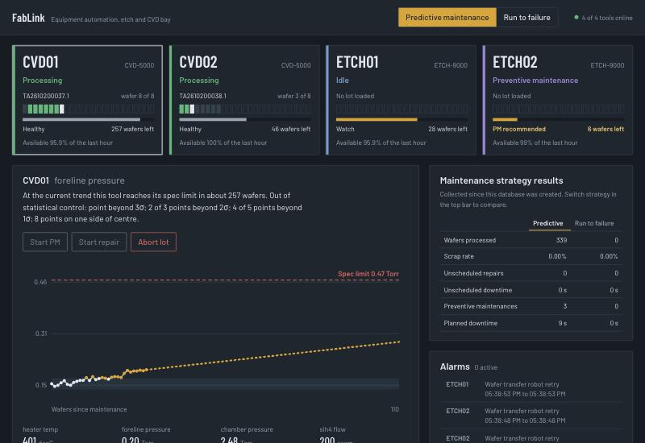
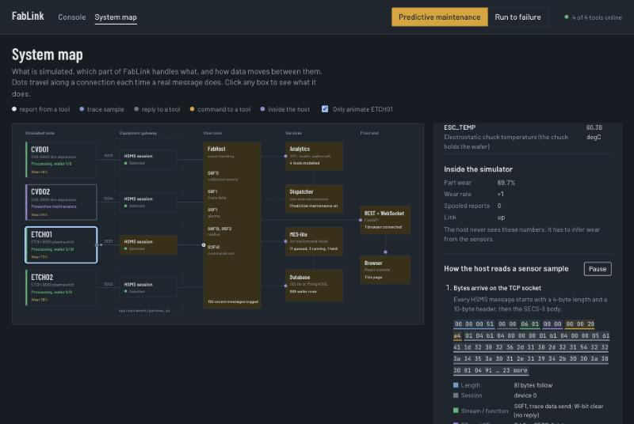
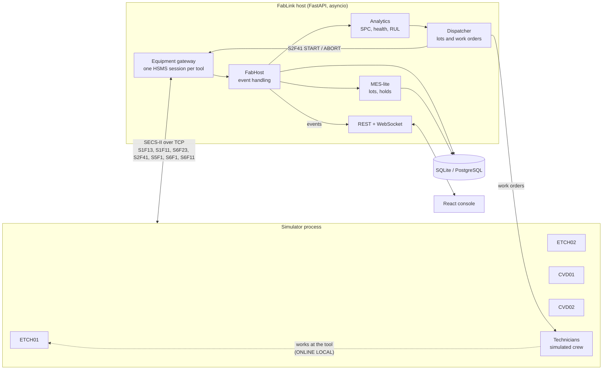

# FabLink: equipment automation & predictive maintenance

FabLink is a learning project: a small **Equipment Automation Program (EAP)**
for a simulated semiconductor etch / CVD bay. It talks to (simulated) process
tools over a subset of **SECS/GEM on HSMS**, tracks lots through an MES-style
dispatcher, and uses the tools' sensor data to predict when a tool will drift
out of spec, so maintenance can be scheduled before it scraps wafers.

> **What this is, and what it isn't**
>
> - A portfolio prototype. It is **not connected to any real fab equipment**
>   and has not been tested against a real tool.
> - All equipment and all data are **simulated**. The failure behaviour
>   (wear, drift, breakdowns) is written into the simulator, so the
>   predictive-vs-reactive comparison shows the mechanics working, not
>   evidence of real-world savings.
> - The SECS/GEM layer implements **a subset** of SEMI E5 / E37 / E30
>   behaviour, written from publicly available descriptions of the
>   standards for learning purposes. It is **not SEMI-certified** and not
>   GEM-compliant. See [SECS/GEM scope](#secsgem-scope) for exactly what is
>   and isn't there.

**Try it in your browser: [martic1101.github.io/fablink](https://martic1101.github.io/fablink/)**,
a recorded demo with nothing to install. It is the real console replaying a
recorded run, not a video: click any tool, open the System map and replay
the scenarios. Controls that would change the system are turned off there;
run it locally (below) for the live version.



```bash
make setup     # Python venv + npm install
make demo      # → http://localhost:8000
```

Click **Run to failure** in the top bar to let tools run until they break:
lots go on hold, wafers get scrapped and unscheduled downtime piles up.
Switch back to **Predictive maintenance** and the host raises PM work orders
before that happens.

The top bar also has the simulation controls:

- **Pause simulation / Start simulation** freezes and resumes simulated time
  (wafers, maintenance, technician travel) and the dispatcher. HSMS links stay
  up while paused, so nothing has to reconnect.
- **Shut down** stops the simulator and the host after a confirmation, the
  same as Ctrl+C in the terminal. Start again with `make demo`. Set
  `ALLOW_SHUTDOWN=0` to hide this from shared deployments.

## System map: see how it works

The **System map** page (top bar, or http://localhost:8000/#/map) explains the
running system rather than just monitoring it:

- **Live architecture diagram.** Every simulated tool, its HSMS session in the
  equipment gateway, the host core, analytics, dispatcher, MES, database, API
  and the (simulated) technicians. A dot travels along a connection each time
  a real message does, and each box lights up when that part of the system
  acts. Click a box to see what it is responsible for and which file
  implements it.
- **How a reading is decoded.** Click a tool to see its latest `S6F1` trace
  message three ways: the raw bytes on the socket, colour-coded by HSMS header
  field; the decoded SECS-II items; and the named sensor values, mapped
  through the `S1F12` namelist the tool sent when it connected.
- **Scenarios.** Trigger something in the simulator and watch the system
  respond, one step at a time:

  | Scenario | What the simulator does | What you see the system do |
  | --- | --- | --- |
  | Read one wafer | nothing | WAFER_STARTED → trace samples → WAFER_COMPLETED → per-wafer feature → health update → database row → WebSocket push |
  | Wear speeds up | part wears 3× faster | trend detected → PM recommended → PM work order, tool held → technician switches tool to ONLINE LOCAL → tool reports MAINT_STARTED / COMPLETED |
  | Part fails suddenly | part at 99.5 % wear | S5F1 alarm → lot on HOLD → DOWN → repair work order → technician at the tool → alarm cleared → tool back to IDLE |
  | Network drops | link cut for 8 s | gateway notices → retries with backoff → tool spools reports → reconnect → S6F23 → spooled reports replayed |
  | Reply gets lost | host's ack to one report "lost" | tool times out (T3) and resends → host recognises the DATAID and ignores the duplicate |

  Each step ticks off when the responsible block reports it in the host's
  activity stream (`GET /api/activity`, or live over the WebSocket). The
  simulator's ground truth (actual wear, spool size) is shown next to what the
  host inferred, so it is clear that the host only ever sees sensor data.



The scenario controls are a demo-only API on the simulator
([`simulator/control.py`](backend/simulator/control.py)), proxied by the host
under `/api/sim`. Real equipment has no such back door.

---

## Why this project

It is built around the work of a fullstack engineer in fab automation:

| What the job needs | Where it lives in this repo |
| --- | --- |
| Integrate manufacturing equipment with production systems | [`app/secs`](backend/app/secs): SECS-II codec and HSMS transport (subset, written for learning); [`app/equipment/gateway.py`](backend/app/equipment/gateway.py): connection management, discovery, remote commands, spool retrieval |
| Predictive maintenance & diagnostic tools | [`app/analytics`](backend/app/analytics): per-wafer FDC features, Western Electric SPC rules, EWMA health score, remaining-wafers estimate; work orders and tool holds in [`app/host.py`](backend/app/host.py) |
| Minimise downtime, improve reliability | Reconnect with backoff, T3 reply timeouts, linktest, GEM-style spooling with S6F23, at-least-once delivery with duplicate filtering, crash recovery of in-process lots and open work orders |
| Unit, integration and regression tests | 88 backend tests (protocol, analytics, simulator, full-stack integration, API) and 15 frontend tests; a regression test for every bug in the [engineering notes](docs/engineering-notes.md) |
| Front-end (React) | [`frontend/`](frontend): React 19 + TypeScript, live over WebSocket, SVG charts and diagram |
| SQL databases | SQLAlchemy 2 (async) on SQLite for zero-setup, PostgreSQL in Docker / CI |
| Technical documentation | This README, [architecture](docs/architecture.md), [engineering notes](docs/engineering-notes.md) |

## Architecture



**One wafer, end to end**

1. The dispatcher picks the highest-priority queued lot for an idle tool, but
   first asks the tool's health model whether the lot would push the tool past
   its spec limit. If it would, it raises a PM work order instead and holds
   the tool.
2. `S2F41 START` goes to the tool; the tool acks with `HCACK=4` and reports
   `S6F11 LOT_STARTED`, `WAFER_STARTED`, then streams `S6F1` trace data.
3. On `WAFER_COMPLETED` the host averages the health sensor over the wafer
   (an FDC summary statistic), feeds it to the health model (EWMA, SPC rules,
   least-squares trend → wafers until spec limit) and stores a `wafer_results` row.
4. Everything is pushed to the browser over a WebSocket.

**Maintenance.** The host never performs maintenance or starts it over SECS.
It raises a work order (predictive, after a failure, or by an engineer),
stops dispatching to the tool, and hands the work order to the technicians,
here a simulated crew and in a fab a maintenance system and people. A
technician switches the tool to ONLINE LOCAL (it then refuses remote
commands), does the work at the tool, and the tool reports `MAINT_STARTED` /
`MAINT_COMPLETED`, which closes the work order and releases the tool.

More detail, including message sequences, is in [docs/architecture.md](docs/architecture.md).

## The online demo

GitHub Pages only serves static files, so the online version replays a
recording instead of running the Python host. `make record-demo` (with
`make demo` running) records about 90 seconds of a real run: every WebSocket
message the console receives, the REST data it polls, and one run of each
System map scenario with its start time. The frontend's demo build
(`npm run build:demo`) swaps the network layer for a player
([`frontend/src/replay`](frontend/src/replay)) that answers the same API calls
"as of" the playback time and delivers the recorded messages on schedule, so
every page is the real UI. Running a scenario there jumps to its recorded
moment. The recording is about 0.3 MB gzip-compressed. The
[Pages workflow](.github/workflows/pages.yml) builds and publishes it on
every push to `main`.

## SECS/GEM scope

Written from scratch for learning; no third-party SECS library is used.

| Implemented (subset) | Not implemented |
| --- | --- |
| SECS-II items: L, A, B, BOOLEAN, I1–I8, U1–U8, F4, F8 | Other item formats (J, C2, …) |
| HSMS-SS: Select, Linktest, Separate, data messages, T3; host is the active side | HSMS-GS, T5/T6/T7/T8 timers, Deselect, Reject handling |
| S1F1/F2, S1F3/F4, S1F11/F12, S1F13/F14 | S1F15/F17 (host-driven online/offline) |
| S2F41/F42 host commands: START, ABORT | Recipe management (S7), equipment constants (S2F13/F15), clock (S2F31) |
| S5F1/F2 alarm reports | Alarm enable/disable (S5F3), alarm list (S5F5) |
| S6F11/F12 event reports with fixed report contents | Dynamic report definition (S2F33/F35/F37) |
| S6F1/F2 trace data, sent unsolicited | Trace initialisation by the host (S2F23) |
| Spooling of S5/S6 while the host is away; S6F23 request / purge | Spool configuration (S2F43), spool size limits per stream |
| GEM control state: ONLINE REMOTE / ONLINE LOCAL as events | Full E30 control and processing state machines, OFFLINE states |
| Error replies by transaction abort (SxF0) | Stream 9 error messages |
| Lot start as a single host command | GEM300: E40 process jobs, E94 control jobs, E87 carrier management, E90 substrate tracking |

Equipment states are a simplified E10-style set (IDLE, PROCESSING, PM, DOWN,
OFFLINE) reported by the tool; real E10 has six top-level states and is
usually derived by the host / MES.

## The simulated tools

Each tool is an asyncio TCP server that behaves like equipment: it listens as
the HSMS passive side, answers the stream 1 messages above, validates remote
commands like a tool would (`HCACK=2` if it's busy or in local control, `3`
for bad parameters), and sends its reports through one ordered outbox that
doubles as the spool.

Every wafer wears a consumable part (an RF matching network on etchers, a
vacuum pump on CVD tools). One sensor drifts with that wear, accelerating
towards the end of life. Past ~88 % wear wafers start to be scrapped; at
100 % the part fails, the tool raises an alarm, aborts the lot and goes DOWN
until a technician repairs it. A repair takes about 4× as long as a PM.

## Running it

| | |
| --- | --- |
| `make setup` | Creates `backend/.venv`, installs Python and npm dependencies |
| `make demo` | Builds the UI, starts 4 simulated tools, the technicians and the host. Open http://localhost:8000. Stop with Ctrl+C or the console's **Shut down** button |
| `make dev` | Same, but with API auto-reload and the Vite dev server on :5173 |
| `make test` | Backend (pytest) and frontend (vitest) tests |
| `make docker` | Full stack on PostgreSQL via Docker Compose |

`SIM_SPEED=10 make demo` runs the fab 10× faster. API docs are at
http://localhost:8000/docs.

Configuration is through environment variables (see
[`app/config.py`](backend/app/config.py)). The tool list is
`FAB_EQUIPMENT="ETCH01@host:port,..."`, and `SIM_CONTROL_URL` points at the
simulator's control API, which also receives work orders.

Requires Python ≥ 3.9 and Node ≥ 20. The Docker / PostgreSQL path is
exercised by CI; it was not run on the machine this was developed on.

## Tests

```
backend/tests/
  test_codec.py        SECS-II encoding, known byte layouts, malformed input
  test_hsms.py         select, request/reply, T3 timeout, transaction abort, system-byte collision
  test_spooling.py     ordered outbox, spool held until S6F23, resend after T3 without stalling
  test_analytics.py    every Western Electric rule, RUL accuracy, status escalation
  test_simulator.py    command validation, local control, technician maintenance, failure physics
  test_sim_control.py  scenario control API, technician inbox, the host's proxy
  test_integration.py  real tools + host + DB on loopback: discovery, lot completion,
                       failure → hold → single repair, predictive PM with the tool held,
                       manual work orders, reconnect and replay, duplicate events,
                       partial-lot release, restart recovery, each scenario's activity
  test_api.py          REST validation, error codes, work orders, WebSocket snapshot
```

The integration tests run the real simulator and crew against the real host
at 40× speed; the whole suite takes about 13 s. CI runs it on Python 3.9 and
3.12, then brings the Docker Compose stack up on PostgreSQL and waits for real
lots to complete.

## Design decisions

- **Speak a real (subset of the) protocol instead of JSON.** The hard parts of
  equipment integration, such as transaction matching, timeouts, a peer that
  sends unsolicited messages and links that drop, only show up on a real
  protocol.
- **At-least-once reporting.** A report whose reply times out is resent, and
  the host drops duplicates by DATAID. Losing an event (a wafer, an alarm) is
  worse than seeing it twice.
- **The host raises work orders, people do maintenance.** The dispatcher holds
  a tool instead of commanding it into maintenance; the tool's own reports
  drive the work order's lifecycle.
- **Asyncio, one task per tool.** Many mostly idle TCP sessions suit an event
  loop; every request has a T3 timeout, so a slow tool can't block the others.
- **Trace data stays in memory; wafer summaries go to SQL.** Raw sensor traces
  belong in a time-series store; the relational DB keeps one row per wafer,
  which is what SPC and the dashboard need.
- **Short trend window for RUL.** Wear accelerates near end of life, so a line
  fitted over the last 8 wafers tracks the curve better than one fitted over
  everything since the last PM. It is a simple heuristic, not a validated model.

## What I'd do next

- Host-driven trace setup (S2F23), dynamic event reports (S2F33/35/37) and
  Stream 9 error handling.
- GEM300 job model (E40 / E94) instead of a single START command.
- Post-maintenance qualification: keep the tool held until monitor wafers pass.
- Fit the degradation model from labelled run-to-failure data with prediction
  intervals, and evaluate it on held-out simulated failures.
- Alembic migrations, authentication and an audit log for remote commands and
  work orders.

## Credits

Built with FastAPI, SQLAlchemy, Pydantic, httpx, uvicorn, React, Vite and
Vitest. All SECS/HSMS, simulator and analytics code in this repository is
written for this project.

Related open-source projects: [bparzella/secsgem](https://github.com/bparzella/secsgem),
a Python SECS/GEM implementation that would be the natural starting point for
production work, and general industrial-monitoring examples such as
[FactoryPulse](https://github.com/lewisndambiri/factorypulse) and
[industrial-iot-machine-monitoring](https://github.com/davenputra-cmd/industrial-iot-machine-monitoring).
