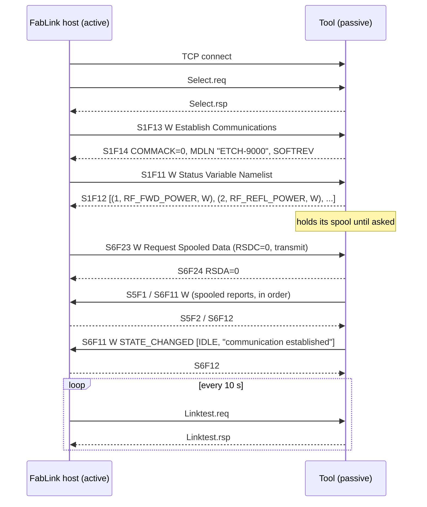
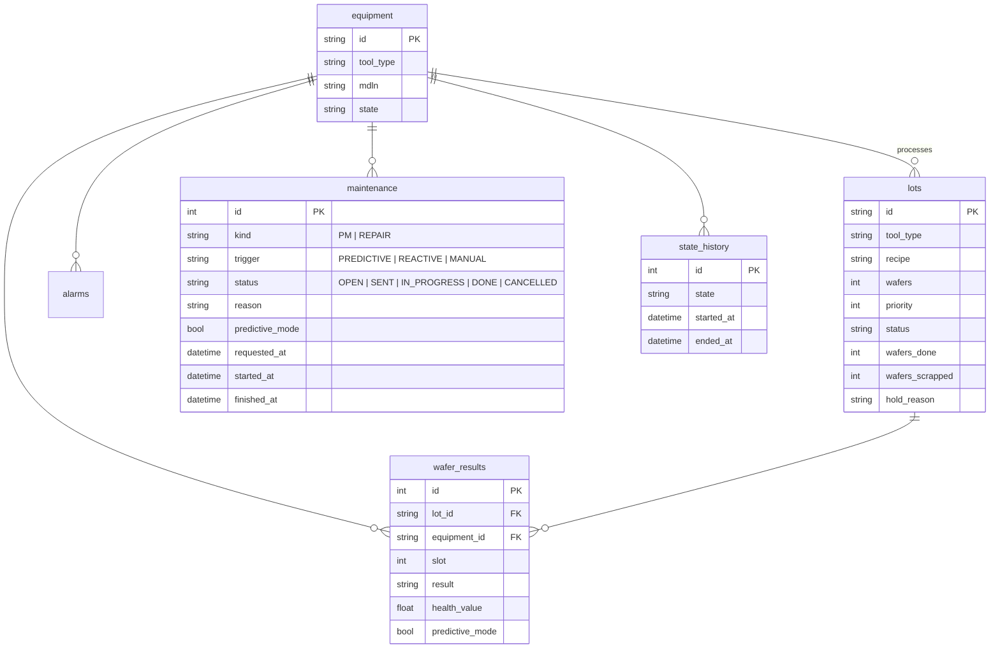

# Architecture

## Components

| Module | Responsibility |
| --- | --- |
| `app/secs/codec.py` | SECS-II item encoding/decoding (SEMI E5), SML rendering for logs |
| `app/secs/hsms.py` | HSMS transport (SEMI E37): framing, Select, Linktest, Separate, request/reply matching, T3 timeout, transaction abort |
| `app/secs/messages.py` | The host↔tool contract: CEIDs, RCMDs, HCACK codes, message builders/parsers. Shared by host and simulator so they can't drift apart |
| `app/equipment/gateway.py` | One `EquipmentLink` per tool: connect → Select → S1F13 → S1F11 discovery → S6F23 spool request, reconnect with exponential backoff, `command()` for S2F41, duplicate-event window |
| `app/host.py` | `FabHost`: turns equipment events into MES updates, health-model updates, DB rows and WebSocket pushes; raises maintenance work orders and holds tools; runs the dispatcher |
| `app/maintenance.py` | Where work orders go (`WorkOrderSink`); the demo implementation posts them to the simulated technicians |
| `app/analytics/` | `spc.py` Western Electric rules, `health.py` EWMA + RUL, `kpi.py` availability and strategy comparison |
| `app/mes/service.py` | Lot creation, dispatch rule (priority then FIFO), hold release |
| `app/api/routes.py` | REST endpoints and the `/api/ws` WebSocket |
| `simulator/tool.py` | Simulated tools that speak HSMS as the passive side, with an ordered outbox / spool |
| `simulator/crew.py` | Simulated technicians: receive work orders, work on the tool in ONLINE LOCAL |
| `simulator/control.py` | Demo-only control API: scenario controls and the technicians' work-order inbox |
| `frontend/` | React console |

## Activity stream

Every block reports what it did through `FabHost.activity(block, tool, kind,
text)`: gateway (`link.up`, `link.down`, `link.retry`), host (`state`,
`wafer.started`, `trace.first`, `alarm.set`, `control`, `maint.started`,
`spool.replayed`, `event.duplicate` …), analytics
(`analytics.feature`, `analytics.health`), dispatcher (`dispatch.lot`,
`wo.opened`, `wo.sent`, `wo.cancelled`), MES (`lot.started`, `lot.hold` …),
database (`db.wafer`, `repair.opened`) and API (`ws.pushed`). Entries are kept
in memory (last 600), served at `GET /api/activity` and pushed over the
WebSocket. The System map animates from them, and its scenario steps are
predicates over them ([`frontend/src/map/scenarioDefs.ts`](../frontend/src/map/scenarioDefs.ts)).

## Connection lifecycle



The host learns the tool type from `MDLN` and the meaning of each trace value
from `S1F12`, so adding a tool is a configuration change, not a code change.
The final "communication established" state event is this project's
convention for "replay finished"; the host counts the reports before it.

### Reports: ordered, at-least-once

The tool sends alarms and events one at a time from a single outbox, each with
the W-bit. If the session drops, the report goes back to the head of the
outbox, which is the spool. If the reply times out (T3) on a live session, the
host may well have processed it, so the tool resends it after a pause rather
than waiting for a reconnect. The host keeps a window of recent
`(DATAID, CEID, values)` keys per tool and acknowledges, but does not apply, a
report it has already seen. Alarm reports are idempotent by state (an already
open alarm is not opened twice).

## Processing a lot

```mermaid
sequenceDiagram
  participant D as Dispatcher
  participant H as FabHost
  participant T as Tool
  D->>D: next lot for tool type; health model: will it finish within spec?
  alt tool predicted to cross spec limit
    D->>D: raise PM work order, hold the tool (see Maintenance)
  else healthy
    D->>T: S2F41 START LOTID, RECIPE, WAFERS
    T-->>D: S2F42 HCACK=4 (will finish later)
    T->>H: S6F11 STATE_CHANGED PROCESSING, LOT_STARTED
    loop each wafer
      T->>H: S6F11 WAFER_STARTED
      T->>H: S6F1 trace data (every 0.5 s)
      T->>H: S6F11 WAFER_COMPLETED [lot, slot, OK|SCRAP]
      H->>H: feature = mean(health sensor) → SPC, EWMA, RUL → wafer_results
    end
    T->>H: S6F11 LOT_COMPLETED, STATE_CHANGED IDLE
  end
```

If the part fails mid-lot, the tool sends `S5F1` (alarm set), `LOT_ABORTED`
and `STATE_CHANGED DOWN`. The host puts the lot on HOLD with the alarm text as
the reason and raises a REPAIR work order; downtime counts from now, not from
when the technician arrives.

## Maintenance

The host does not perform maintenance and there is no remote command for it.

```mermaid
sequenceDiagram
  participant D as Dispatcher (host)
  participant C as Technicians
  participant T as Tool
  D->>D: open work order (PM: predicted / REPAIR: tool DOWN / MANUAL)
  Note over D: tool held: no new lots
  D->>C: work order (WorkOrderSink)
  C->>C: travel; for a PM wait until the current lot finishes
  C->>T: switch to ONLINE LOCAL, work at the tool
  T->>D: S6F11 CONTROL_STATE_CHANGED [ONLINE_LOCAL]
  T->>D: S6F11 STATE_CHANGED [PM or DOWN], MAINT_STARTED [kind, work order]
  Note over T: refuses S2F41 while LOCAL (HCACK=2)
  T->>D: S5F1 alarm cleared (repair), MAINT_COMPLETED [kind, work order]
  T->>D: S6F11 CONTROL_STATE_CHANGED [ONLINE_REMOTE], STATE_CHANGED [IDLE]
  D->>D: close work order, reset health model, release the tool
```

Work order states: `OPEN` (raised, tool held) → `SENT` (with the technicians)
→ `IN_PROGRESS` (tool reported MAINT_STARTED) → `DONE`, or `CANCELLED` when a
pending PM is superseded by a failure. With `auto_work_orders` off, an
engineer sends each work order from the console. Open work orders are
restored on host restart, so held tools stay held. A real fab would also keep
the tool held after maintenance until qualification wafers pass; that is not
modelled.

## Data model



`state_history` stores E10-style state intervals, from which availability is
computed. `predictive_mode` on wafers and maintenance lets the dashboard
compare both strategies on the same database.

## Health model

For each wafer the host computes one feature: the mean of the tool type's
health sensor (RF reflected power for etch, foreline pressure for CVD) while
the wafer was in the chamber.

- **Baseline / SPC.** The first 8 wafers after a maintenance define the
  control limits (mean ± 3σ). Later wafers are checked against the Western
  Electric rules plus a 6-point trend rule. This flags drift long before the
  spec limit.
- **Health score.** An EWMA (λ = 0.3) of the feature, expressed as the share
  of the nominal-to-spec margin that's left.
- **Remaining useful life.** A least-squares line over the last 8 wafers,
  extrapolated to the spec limit. Short window on purpose: degradation
  accelerates, and a long window would underestimate the slope.
- **Decision.** `needs_pm_before(n)` is true if the tool is predicted to
  cross the spec limit within the next lot's `n` wafers plus a 3-wafer margin.

## Reliability

| Failure | Handling |
| --- | --- |
| Tool unreachable / reboots | Gateway retries with exponential backoff (0.5 s → 10 s); tool shown OFFLINE; state interval recorded |
| Link silently dead | Linktest every 10 s; failure closes the session and triggers reconnect |
| Tool doesn't answer a command | T3 timeout (5 s) → API returns 504, dispatcher retries next cycle |
| Host down while tool reports events | Tool spools S5/S6 reports and sends them when the host asks with S6F23 |
| Reply lost / T3 on a live session | Tool resends that report; host drops it by DATAID |
| Late handler from a dropped session | Host keeps the OFFLINE interval; the tool's reported state is tracked separately from link status |
| Host crashes mid-lot | On start, DISPATCHED/RUNNING lots go to HOLD for disposition; health models are rebuilt from `wafer_results` |
| Handler throws | Peer gets `SxF0` (transaction abort) instead of waiting for T3 |
| Slow browser | Per-client bounded queue; messages are dropped for that client, never block the equipment path |
